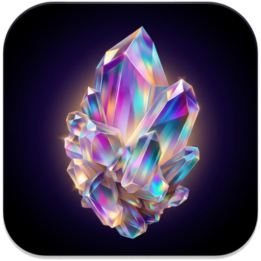

  

<h1 align="center">Crystal Notes</h1>

  Офлайн-заметки и списки задач в одном HTML-файле. 
  Offline notes and to-do lists in a single HTML file.

  <a href="https://github.com/Finn013/CrystalNotes/releases/latest">Скачать / Download</a> ·
  <a href="https://finn013.github.io/CrystalNotes/">Открыть онлайн / Open online</a>

---

## 🇷🇺 О приложении

Crystal Notes — лёгкое приложение для заметок и задач. Работает без интернета и без регистрации: все данные хранятся на вашем устройстве. При желании заметки синхронизируются между устройствами через ваш собственный приватный репозиторий GitHub с шифрованием.

### Возможности
- **Заметки** с простым оформлением: `**жирный**`, `*курсив*`, списки и `#теги`; цвет карточки, закрепление, счётчик слов.
- **Списки задач** с вложенными пунктами, приоритетами (высокий, средний, низкий) и фильтрами «Все / Активные / Выполненные».
- Перетаскивание для изменения порядка, вид плиткой или списком.
- **Поиск** по заметкам, задачам и тегам.
- **QR-код** заметки или списка — удобно перенести текст на телефон.
- Статистика: количество заметок, задач и процент выполненного.
- Светлая и тёмная тема с выбором цвета акцента, отдельный **E-Ink режим**.
- **Синхронизация через GitHub** с шифрованием AES-256-GCM: пароль и токен хранятся только на устройстве.
- Экспорт и импорт всех данных в `.json`.

## Скачать

| Платформа | Файл | Статус |
|---|---|---|
| Любое устройство с браузером | `CrystalNotes.html` | ✅ Доступно |
| Android 7+ | `CrystalNotes.apk` | ✅ Доступно |
| Windows 10/11 | `CrystalNotes-Setup.exe`, `CrystalNotes-Portable.exe` | ✅ Доступно |
| iPhone, iPad, Mac | [finn013.github.io/CrystalNotes](https://finn013.github.io/CrystalNotes/) | ✅ Доступно |

Все файлы — в [релизах](https://github.com/Finn013/CrystalNotes/releases/latest).

**iPhone/iPad:** откройте ссылку в Safari → «Поделиться» → «На экран Домой».
**Mac:** Safari → «Файл» → «Добавить в Dock» (в Chrome/Edge — значок установки в адресной строке).
После первого открытия приложение работает без интернета.

> Сборки Windows не подписаны: если SmartScreen предупредит, нажмите «Подробнее» → «Выполнить в любом случае».

> Данные хранятся на этом устройстве. Делайте резервные копии (Меню → «Экспорт данных») или включите синхронизацию.

## Идеи и ошибки
Пишите в [Issues](https://github.com/Finn013/CrystalNotes/issues).

---

## 🇬🇧 About

Crystal Notes is a lightweight notes and to-do app. No internet, no sign-up: everything stays on your device. Optionally sync between devices through your own private GitHub repository, with encryption.

### Features
- **Notes** with simple formatting (`**bold**`, `*italic*`, lists, `#tags`), card colors, pinning, word count.
- **To-do lists** with nested items, priorities and All / Active / Done filters.
- Drag to reorder, grid or list view.
- **Search** across notes, tasks and tags.
- **QR code** for any note or list.
- Stats, light/dark themes with accent colors, **E-Ink mode**.
- **GitHub sync** with AES-256-GCM encryption; the password and token never leave the device.
- Export / import everything as `.json`.

## Download
- **Any browser:** `CrystalNotes.html`
- **Android 7+:** `CrystalNotes.apk`
- **Windows 10/11:** `CrystalNotes-Setup.exe` or `CrystalNotes-Portable.exe`
- **iPhone, iPad, Mac:** open [finn013.github.io/CrystalNotes](https://finn013.github.io/CrystalNotes/) in Safari and add it to the Home Screen / Dock.

All files are in [Releases](https://github.com/Finn013/CrystalNotes/releases/latest). Windows builds are unsigned; if SmartScreen warns, click “More info” → “Run anyway”.

> The interface is in Russian. Data lives on your device — keep backups or enable sync.
